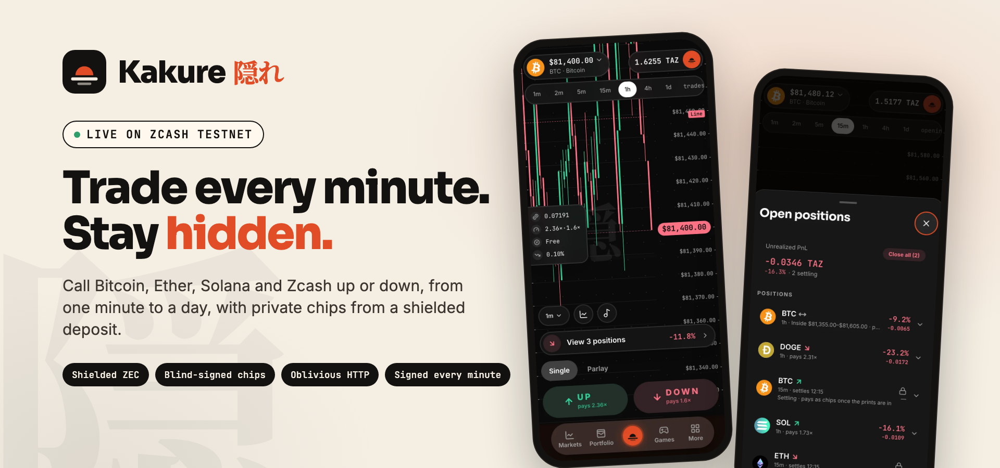
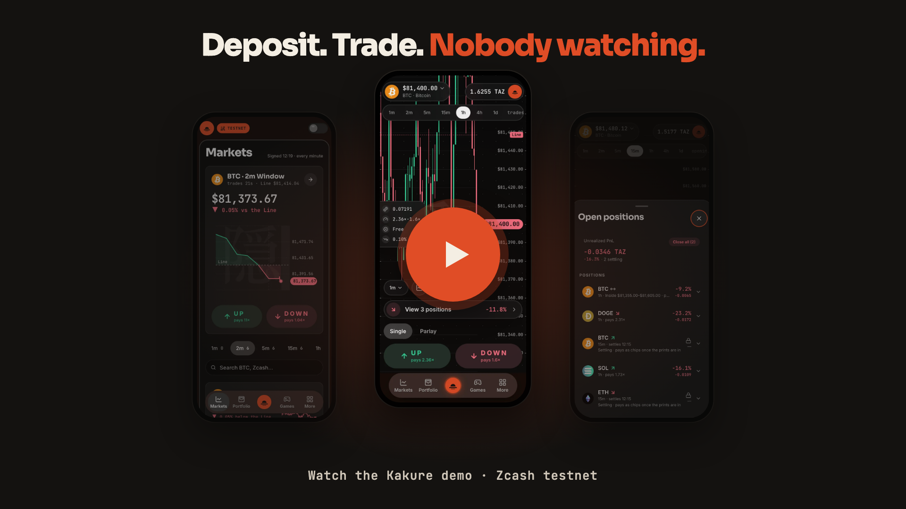
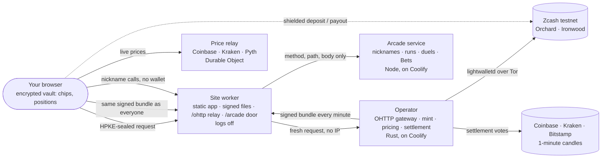

<p align="center">
  <a href="https://kakure-web.kakure-price-relay.workers.dev">
    
  </a>
</p>

<h1 align="center">Kakure · 隠れ</h1>
<p align="center">Trade every minute. Stay hidden.<br/>A private, real-time prediction market on Zcash: the prices are public, the traders aren't.</p>

<p align="center">
  <a href="https://kakure-web.kakure-price-relay.workers.dev"><b>Open Kakure</b></a>
  &nbsp;·&nbsp;
  <a href="https://kakure-web.kakure-price-relay.workers.dev/demo"><b>Demo</b></a>
  &nbsp;·&nbsp;
  <a href="https://kakure-web.kakure-price-relay.workers.dev/privacy"><b>Who sees what</b></a>
  &nbsp;·&nbsp;
  <a href="https://kakure-web.kakure-price-relay.workers.dev/proof"><b>Settlement proof</b></a>
  &nbsp;·&nbsp;
  <a href="https://kakure-web.kakure-price-relay.workers.dev/status"><b>Status</b></a>
  &nbsp;·&nbsp;
  <a href="apps/docs/content/docs/index.mdx"><b>Docs</b></a>
</p>

**Kakure is a prediction market where nobody, including us, can tell who placed a trade.** You deposit shielded ZEC once
and get private chips, blind-signed so the mint can't tell which deposit they came from. With them you call Bitcoin,
Ether, Solana, Dogecoin, XRP or Zcash up or down over Windows from one minute to a day, at a live price from a public
formula. Every request travels through Oblivious HTTP, so the relay sees your IP but not the trade, and the operator
sees the trade but not your IP. Settlement is signed every minute from three exchanges' public candles, and anyone can
recompute it.

Built for **ZECATHON · Private Markets**. *Kakure* (隠れ) means **hidden**. It runs on **Zcash testnet** with TAZ,
which has no value; mainnet is built and keyed but not opened. See [what is verified](#what-is-verified) for what has
been run end to end and what hasn't.

## Problem and value

**Prediction markets leak their traders.** On a public chain every bet is a transaction tied to an address; on a
hosted venue every bet sits in an account with a name, an email and an IP. Either way the most interesting thing a
trader has, their view, is visible to someone.

**Kakure separates the price from the person.** The price, the formula, volatility, caps, outcomes and the house's
book are public and signed. Who traded, how much and when stays with the trader: shielded Zcash for money in and out,
Chaumian e-cash (Cashu BDHKE with DLEQ proofs) for the balance, and Oblivious HTTP (RFC 9458) for every call.

**One call.** Open the terminal on BTC and pick the 5-minute Window. The opening print from three exchanges sets the
Line. Up pays if two of three venues close at or above it; Down if two close below; otherwise everyone is refunded at
cost. The button shows what Up pays right now (say **2.36×**), priced as Φ(ln(S/L) / σ√τ) plus a spread. Tap it: your
browser spends chips the mint has never seen unblinded, sealed to the operator's gateway key, and gets back a signed
position certificate. Close early at the live bid, or let it settle; winnings come back as fresh chips.

| Way in | What you do | Start here |
| --- | --- | --- |
| **Trade** | Up or Down on 1m, 2m, 5m, 15m, 1h, 4h and 1d Windows; close early, trail, take-profit and stop; parlays of 2–3 Windows; Range and Moonshot bands. | [Trade](https://kakure-web.kakure-price-relay.workers.dev/trade) · [first trade](apps/docs/content/docs/first-trade.mdx) · [rules](apps/docs/content/docs/rules.mdx) |
| **Play** | Practice against a coin, Line Rider and Candle Hop on real price tapes, Lucky (one real trade drawn on your device), and a free Duel with sealed picks and Elo. | [Games](https://kakure-web.kakure-price-relay.workers.dev/games) · [games guide](apps/docs/content/docs/games.mdx) |
| **Rank** | Nickname boards for the arcade and the Duel, and an opt-in Bets board of published calls (right calls only, never a market, side or size). | [Leaderboard](https://kakure-web.kakure-price-relay.workers.dev/leaderboard) |
| **Check it** | Recompute any settlement from the signed prints; check your own positions against the signed record. | [Proof](https://kakure-web.kakure-price-relay.workers.dev/proof) · [Verify](https://kakure-web.kakure-price-relay.workers.dev/verify) · [how](apps/docs/content/docs/verify.mdx) |

There is no account, no sign-in and no cookie. Everything you own lives in an encrypted vault on your device, with an
optional passphrase lock and an encrypted backup file.

## Demo video

<p align="center">
  <a href="https://kakure-web.kakure-price-relay.workers.dev/demo">
    
  </a>
</p>

The play button opens the site's [demo page](https://kakure-web.kakure-price-relay.workers.dev/demo). The cover is
artwork composed from unchanged screens of the app ([provenance](.github/assets/provenance.json)); it is not a
recording and shows no transaction.

## Who sees what

<sub>The full model, with every residual, is on [/privacy](https://kakure-web.kakure-price-relay.workers.dev/privacy) and in [privacy.mdx](apps/docs/content/docs/privacy.mdx).</sub>

| Who | Learns | Never learns |
| --- | --- | --- |
| Anyone watching the chain | That shielded deposits and payouts happened, their timing and shape | Amounts, memos, senders, or which trades they paid for |
| The site and its relay (one Cloudflare Worker) | Your IP, when you visit and trade, which network | What's inside a request (sealed to the operator's key); the asset or Window you look at (it stays in the `#fragment`) |
| The operator | Each deposit's amount; each trade's Window, side, stake and time | Your IP; which deposit paid for which trade; who you are |
| Everyone else | The formula, σ, spread and caps; signed prices and outcomes; the chip keys; the house's book, hourly and rounded up; volume per Window in whole groups of three | Any single trade, but for the n−1 case the docs name |

How that holds:

- **Blind-signed chips.** A deposit mints chips in standard amounts; the mint signs blinded outputs (BDHKE on
  secp256k1, [cashu](https://crates.io/crates/cashu) 0.18 on the operator, [@noble/curves](https://github.com/paulmillr/noble-curves)
  in the browser, checked against the NUT-00/02/12 vectors), each with a DLEQ proof against the one published keyset,
  so no chip can be marked. Trades spend chips the mint never saw unblinded.
- **Oblivious HTTP for every call** (RFC 9458: [ohttp](https://crates.io/crates/ohttp) in the gateway,
  [ohttp-ts](https://www.npmjs.com/package/ohttp-ts) in the browser). The relay forwards a fresh request with only its
  content type. Requests and answers are padded to fixed sizes. The gateway key rotates every hour and the old one is
  deleted ten minutes later.
- **The same files for everyone.** Every visitor loads the same signed bundle for both networks on the same minute;
  which asset you watch never reaches the host.
- **Timing and amounts.** Stakes snap to a ladder, chips to a standard split; redeems and withdrawal notes go out at
  random times; a withdrawal address can't be reused.
- **Opt-in social.** Nicknames are bound to a device key with a small proof of work, never to money. Publishing a call
  to the Bets board goes through the operator over the sealed path, so only "right" or "wrong" reaches the arcade.

Kakure runs both the relay and the operator, so keeping your IP apart from your trades rests on Kakure not combining
the two; Tor removes that trust. That and the other residuals (timing, a small crowd, harvest-now-decrypt-later) are
written out on [/privacy](https://kakure-web.kakure-price-relay.workers.dev/privacy).

## Architecture



<sub>More maps (a trade's path, settlement, the deposit) in [system-maps.mdx](apps/docs/content/docs/system-maps.mdx).</sub>

- **The operator** ([services/operator](services/operator)) is one Rust binary: a Zcash wallet on
  [librustzcash](https://github.com/zcash/librustzcash) (`zcash_client_backend` 0.25 pre, `zcash_client_sqlite`,
  Orchard and Ironwood) syncing from `testnet.zec.rocks` over Tor; the Cashu mint; the OHTTP gateway (axum); the
  pricing, caps and positions book; settlement on 2-of-3 venue votes; and the minute loop that signs and pushes the
  public files. Its Ed25519 key is pinned in every client.
- **The site** ([services/data-worker](services/data-worker)) is one Cloudflare Worker serving the static Next.js app,
  the signed files from a Durable Object (a push is accepted only with the operator's signature; `latest.json` only
  moves forward), the OHTTP relay and the arcade door. Observability is off.
- **The web app** ([apps/web](apps/web)) is a static Next.js export with TanStack Query; every signed file is
  verified before it's parsed, and every trade is built and checked in the browser.
- **The arcade** ([services/arcade](services/arcade)) replays every score server-side and keeps nicknames, runs, duels
  and Bets receipts in SQLite; it never receives an IP.

## Built on Zcash

| Piece | Role in Kakure | Code |
| --- | --- | --- |
| **Shielded deposits** | One Orchard-protocol deposit address; a deposit's memo names the device's deposit id; NU6.3 sends land in Ironwood, which the wallet scans and spends. | [scan.rs](services/operator/src/scan.rs) · [deposits.rs](services/operator/src/deposits.rs) · [wallet guide](apps/docs/content/docs/wallet-and-ironwood.mdx) |
| **Shielded payouts** | Withdrawals in standard 1-2-5 notes at random times, one pool per transaction, to an address that hasn't been paid before. | [payouts.rs](services/operator/src/payouts.rs) · [send.rs](services/operator/src/send.rs) |
| **librustzcash** | `zcash_primitives` 0.31, `zcash_client_backend` 0.25, `zcash_client_sqlite` 0.23 (pre-releases carrying testnet NU7), `orchard` 0.16, Tor via the `tor` feature. | [Cargo.toml](services/operator/Cargo.toml) |
| **Address checks in the browser** | A Rust → WebAssembly build of `zcash_address` checks withdrawal addresses on the device. | [packages/zaddr-wasm](packages/zaddr-wasm) |
| **lightwalletd** | `testnet.zec.rocks:443` (mainnet: `zec.rocks`, `us.zec.stardust.rest`), reached over Tor. | [cli.rs](services/operator/src/cli.rs) |

## What is verified

Evidence date: **20 October 2026**, against a local operator on **Zcash testnet** and the local site, unless a row says
otherwise.

| Area | Evidence and limit |
| --- | --- |
| **Trading** | Buys, early closes, partial closes, settlement and redemption, exits (trail, stop, take-profit), parlays and Range/Moonshot bands, walked in the browser on live testnet Windows with chips minted from deposits seeded into the local book. Three trades on one 5-minute Window settled Up and redeemed on 20 October. |
| **Settlement** | Windows settle on 2-of-3 votes from Coinbase, Kraken and Bitstamp 1-minute candles; Proof recomputes them from the signed prints in the browser, and checks the bundle chain. |
| **Oblivious HTTP** | Browser ↔ relay ↔ gateway round trips (GET, POST, 404) decrypt; the hourly key rotation was checked live: a request to the old key is refused as rotated through the relay, the new one round-trips. |
| **Chips** | BDHKE and DLEQ against the NUT vectors on both sides; double spends refused; NUT-19 cached answers for retried calls. |
| **A real shielded deposit and withdrawal on this design** | **Not yet run.** The deposit and payout code paths exist and scan Orchard and Ironwood, but no real testnet deposit has yet reached the current operator; the local wallet has synced to block 4,522,560 with no notes received. The earlier pool-based design took real shielded testnet bets and paid them on 18 October; that design is retired. |
| **Games** | Line Rider and Candle Hop runs replayed server-side to rank; Duels played against a scripted second player, sealed picks revealed only after both locked in, Elo applied once; a Lucky draw made on the device and placed as one trade; a call published to the Bets board through the operator's sealed receipt. |
| **Hosting** | The live site at kakure-web.kakure-price-relay.workers.dev still serves the previous design until the cut-over in the runbook; the operator, arcade and relay deploys are prepared, not yet rolled out. |
| **Mobile** | An Expo app exists for the earlier design and is paused; the web app installs to a phone's home screen. |

No mainnet trading, independent audit or production-money readiness is claimed. Mainnet's operator wallet and signing
key exist. NU7's mainnet activation height isn't published yet; the operator takes it from configuration when it is
([params.rs](services/operator/src/params.rs)) and pauses payouts near an announced height its build doesn't know.

## Run it locally

Use **Node.js 22+**, **pnpm 12**, and **Rust stable** (2024 edition). From the repository root:

```sh
pnpm install --frozen-lockfile
cargo build --manifest-path services/operator/Cargo.toml
```

Live prices come from the price relay, a Cloudflare Worker you can run locally (first terminal):

```sh
pnpm --dir services/price-relay exec wrangler dev --port 8795 --ip 127.0.0.1
```

Create a testnet operator with its own wallet and signing key in `services/operator/operator-data/testnet`, then serve
it (second terminal). `addresses` prints its deposit address; send it testnet TAZ from any Zcash wallet to fund
deposits.

```sh
cd services/operator
./target/debug/kakure-operator init --network testnet
./target/debug/kakure-operator keygen --network testnet
./target/debug/kakure-operator pubkey --network testnet
KAKURE_PRICE_STREAM=ws://127.0.0.1:8795/v1/stream ./target/debug/kakure-operator serve --network testnet
```

Run the site against it (third terminal), pinning the hex key `pubkey` printed. The dev server serves that operator's
signed files at `/data/` and relays `/ohttp/` to its gateway on port 8790, as the Worker does in production:

```sh
NEXT_PUBLIC_DEV_OPERATOR_KEY_TESTNET=<hex key> pnpm --filter @kakure/web dev --port 3001
```

Open [localhost:3001](http://localhost:3001). The arcade is optional (`PORT=8796 npx tsx src/server.ts` in
`services/arcade`, with `DATA_ORIGIN` and `KAKURE_OPERATOR_KEY_TESTNET` set); the docs run with
`pnpm --filter @kakure/docs dev`.

Checks, each judged by its exit code:

```sh
pnpm lint
pnpm typecheck
pnpm test
cargo fmt --check --manifest-path services/operator/Cargo.toml
cargo clippy --manifest-path services/operator/Cargo.toml --all-targets -- -D warnings
cargo test --manifest-path services/operator/Cargo.toml
pnpm --filter @kakure/web build
node scripts/check-privacy.mjs apps/web/out apps/docs/out
```

## Find the code and guides

| Looking for | Start here |
| --- | --- |
| Guides: a first trade, the wallet and Ironwood, backups, networks, troubleshooting | [apps/docs/content/docs](apps/docs/content/docs) |
| Pricing, settlement, the book and the bundle | [services/operator/src](services/operator/src) · [packages/domain](packages/domain) · [file formats](apps/docs/content/docs/file-formats.mdx) |
| Chips, the vault and trades in the browser | [packages/ecash](packages/ecash) · [apps/web/src/features/wallet](apps/web/src/features/wallet) · [apps/web/src/features/vault](apps/web/src/features/vault) |
| Oblivious HTTP | [gateway.rs](services/operator/src/gateway.rs) · [relay.ts](services/data-worker/src/relay.ts) · [packages/ohttp](packages/ohttp) |
| The terminal and chart | [apps/web/src/features/terminal](apps/web/src/features/terminal) · [packages/chart](packages/chart) |
| Games, the arcade and Bets | [apps/web/src/features/games](apps/web/src/features/games) · [packages/arcade](packages/arcade) · [services/arcade](services/arcade) |
| The privacy gate and budgets | [scripts/check-privacy.mjs](scripts/check-privacy.mjs) · [apps/web/scripts/size.mjs](apps/web/scripts/size.mjs) |

Maintained by **Abubakr Jimoh** · [MIT license](LICENSE) · [Third-party notices](THIRD_PARTY_NOTICES.md) ·
[Asset provenance](.github/assets/provenance.json)
