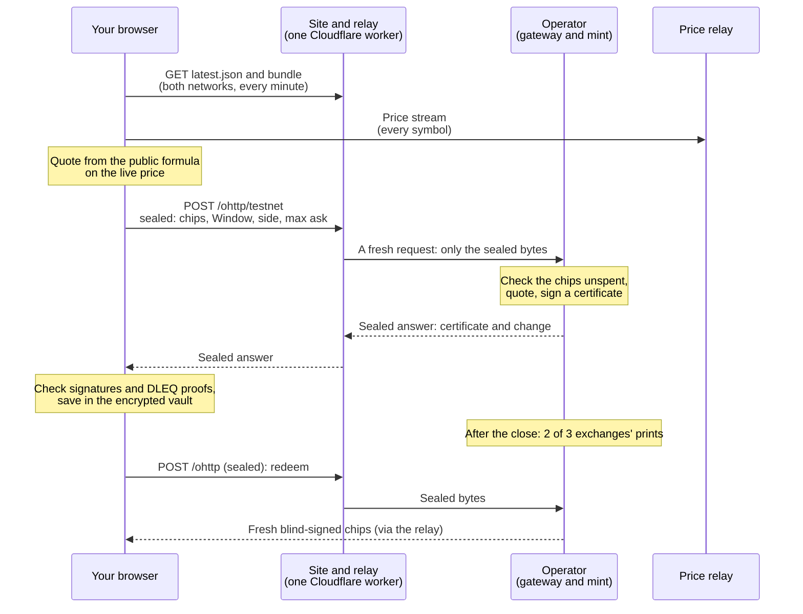
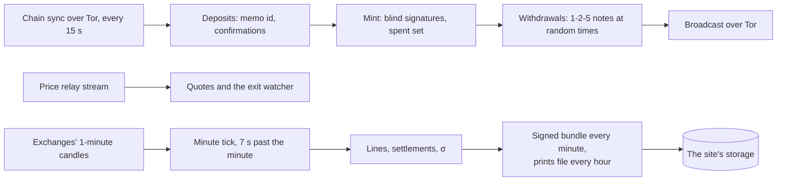
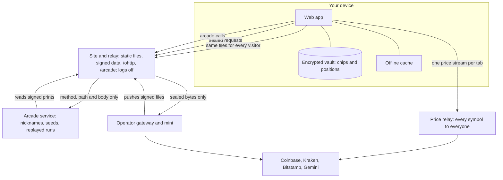
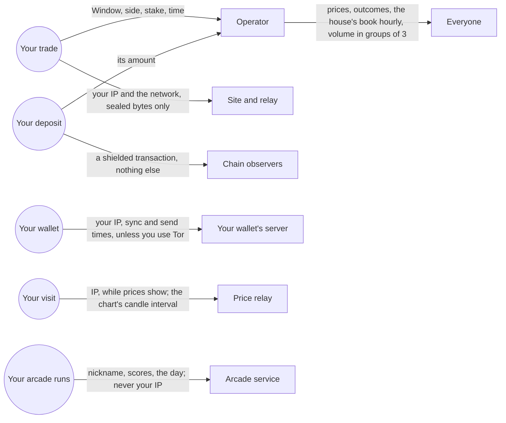

{/* Sources: plan §00 (the new shape, how requests travel); services/data-worker/src (index.ts routes, relay.ts);
   services/operator/src (api.rs gateway, realtime.rs minute tick, exits.rs, payouts.rs, chain.rs); services/price-relay;
   packages/ohttp; packages/ecash; apps/web/src/features/wallet. */}

## A trade, end to end

## The operator's minute

## Data flow

The app never connects to the operator directly: every request is sealed to the operator's published key and goes
through the relay, which forwards only the sealed bytes.

## Who sees what

