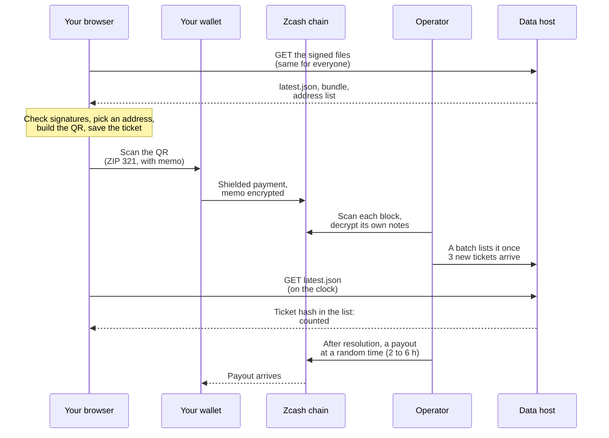
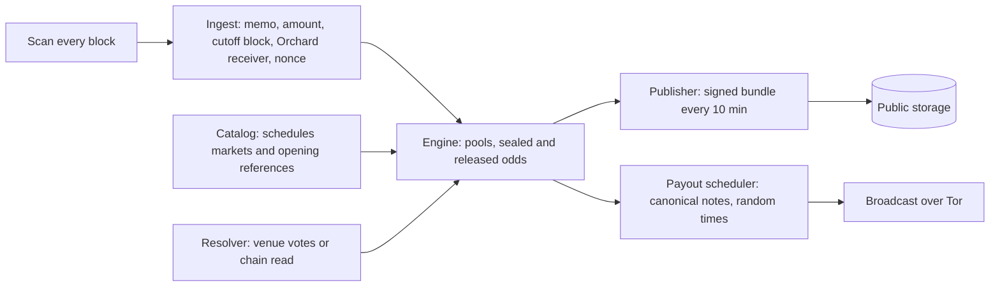
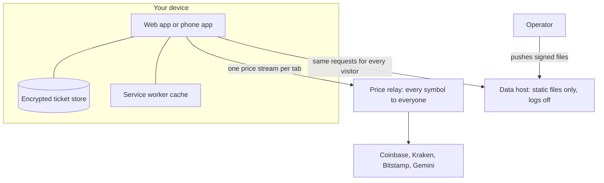
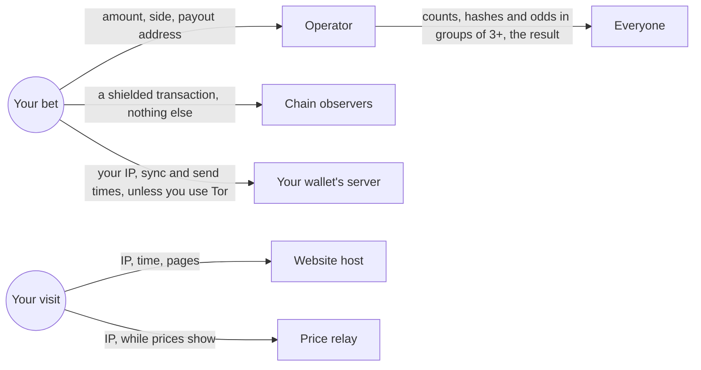

{/* Sources: plan §2 (architecture diagram), §3, §13.9; services/data-worker/src/index.ts; packages/feeds/src/protocol.ts;
   apps/web/public/sw.js; packages/query/src/fetch.ts. */}

## A bet, end to end

## The operator pipeline

## Data flow

The app never calls the operator. The only things it fetches are the signed public files and the price stream.

## Who sees what

